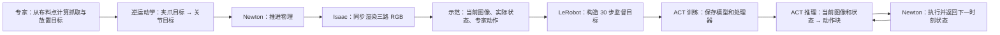

# 双臂叠毛巾：从专家轨迹到 ACT 闭环

这份指南接续 [ACT 入门学习回顾](STUDY_GUIDE.md)。入门课程解释网络内部的注意力、编码器、解码器和 CVAE，这里把这些模块放回工程，跟踪一条专家动作怎样变成训练标签，又怎样由 ACT 预测并执行。

工程已有完整的采集、训练和仿真链路。此前 ACT 在标准初态下能独立抓取、翻折和释放，最佳平均边缘误差为 **51.0 mm**，高于 **25 mm** 的验收线。最近的批量测试验证了两条示范可以进入同一次训练，但 25 步短训所得模型未完成抓取。两次实验解决的问题分别是任务能力与工程链路验收。[排查和修正记录](../training/act/TROUBLESHOOTING_SUMMARY.md)



## 1. 专家怎样生成轨迹

**入口**是 `run_collect.sh`。Isaac 进程启动 Newton worker，worker 重置场景并调用 `start_expert()`。在默认工况中，毛巾是 30×30 cm 的平铺布料。

专家用 `AutoFold.update()` 管理阶段。布料稳定后，它读取仿真粒子位置，从近侧角点求双夹爪的抓取位置，从对应的远侧角点求放置位置。夹爪先到抓取点上方，再下降和闭合。确认两侧抓住后，沿带抬升弧线的路径翻折，再下放、打开、退离，最后等待布料稳定并评价折叠质量。

“指定轨迹”在这里主要指指定**阶段、空间目标和运动形状**。在 `move()` 中，专家先在空间里插值求当前夹爪目标，再用逆运动学算出关节目标。因此，当毛巾初始位置平移时，专家会按当轮布料位置计算目标，形成不同的关节动作序列。Newton 接收关节目标后按限速推进。采集和策略运行共用局部抓取机制，实际夹爪开度、闭合持续时间和布料点位置共同决定是否绑定布料。

**代码阅读顺序**：[AutoFold.update 和 move](../simulation/towel_scene.py)、[Newton 环境的 expert_action 和 step](../simulation/newton_env.py)、[采集物理 worker](../scripts/isaac/live_newton_worker.py)。

## 2. 一条 episode 如何采集

Newton 负责布料与机器人状态，Isaac 负责画面。采集以 **30 Hz** 记录，每个控制周期保持同一目标并推进 **2 个 60 Hz 物理步**。两边按帧号握手。即使渲染较慢，写入的时间戳仍按仿真时间前进。

| 第 t 行字段 | 含义 |
| --- | --- |
| 三路 RGB | 执行动作之前的头部和左右手腕图像，原始存储为 640×480 |
| observation.state | 执行动作之前的 14 个实际臂关节角和 2 个夹爪闭合状态 |
| action | 这个控制周期要执行的 14 个专家目标角和 2 个夹爪闭合指令 |
| timestamp、frame_index | 仿真时间与 episode 内帧号 |

状态和动作都按 `[左臂 7 维, 左夹爪, 右臂 7 维, 右夹爪]` 排列，臂关节单位为弧度，夹爪标签用 0 表示打开、1 表示闭合。**实际角度是输入，目标角度是监督标签**。这一点可以在 `live_bridge.py` 的 `collector.add(state, last_rgbs, response["action"])` 处核对，随后程序才切换到下一帧状态。

每轮写出独立的 LeRobot v3 数据目录。Parquet 保存状态、动作和索引，MP4 保存三路视频，meta 保存字段、统计量和 episode 信息。专家通过折叠验收并完成导出后，采集器写入 `dataset/SUCCESS.json`。批量采集用 `batch.json` 记录每轮偏移与通过状态，训练只取成功条目。第一轮使用标准位置，之后在 X 和 Y 方向采样小幅平移。

**代码阅读顺序**：[同步与采集](../scripts/isaac/live_bridge.py)、[数据写入](../scripts/isaac/collect_dataset.py)、[批量采集](../scripts/isaac/collect_batch.py)。

## 3. ACT 具体学什么

训练脚本校验数据字段并创建训练副本，再用官方 LeRobotDataset 抽查图像和动作块。每个训练样本以一个观察时刻为起点，将三路图像缩放到 **3×240×320**，搭配 **16 维当前状态**，读取从当前帧起的 **30×16 专家动作块**。接近 episode 末尾时，官方加载器用 `action_is_pad` 标记缺失的未来帧。批量模式分别构造各 episode 的样本，再一起采样，归一化统计用纳入训练的完整示范合并计算。

把这里和之前课程的网络对应起来：

- **图像骨干 ResNet-18** 把每路图像转成视觉特征。观测编码器将这些特征和关节状态等输入融合。
- **动作查询与解码器** 产生 30 个时间位置的输出。每个位置预测 16 维目标，因此一次前向输出一个动作块。
- **训练时的 CVAE** 用专家动作块和状态生成潜变量。标准训练用有效动作上的 L1 和 KL 损失更新参数。部署时用零潜变量，现场无需专家答案。
- **项目的可选微调** `--init-checkpoint ... --finetune-z0` 从已有模型起步，直接训练部署用的零潜变量路径，分别计算手臂和夹爪的归一化 L1。批量训练入口也支持标准 ACT 目标。

训练保存模型权重、预处理和后处理配置，并重载核对推理结果。训练目录中的 `dataset_check.json` 可查使用了多少条示范，`train_metrics.jsonl` 可看每次优化更新，`checkpoint/runtime.json` 可查输入输出约定。训练用的固定片段误差衡量拟合情况，折叠能力由闭环验收衡量。

**代码阅读顺序**：[训练副本](../training/act/prepare_data.py)、[样本构造与形状验收](../training/act/common.py)、[训练循环与模型保存](../training/act/stage1.py)。

## 4. 模型怎样接管仿真

`run_act_live.sh` 启动 Isaac 协调进程、Newton 物理进程和 ACT 推理进程。Isaac 把同一时刻的三路 RGB 和实际关节状态送给策略进程。策略加载训练保存的处理器，做缩放和归一化，用 `select_action()` 取出动作并反归一化。Newton 将 16 维动作转成内部关节顺序，按 0.5 阈值把夹爪输出转换为开合目标，应用关节限位并推进物理。新的状态和画面进入下一次推理。

这里有两个容易混淆的长度。**训练动作块始终是 30 步**。运行参数 `--action-steps` 决定预测一次后实际执行多少步再重算。设为 1 时每步重算，设为 30 时按队列执行完整动作块，约 1 秒仿真时间后再看新观测。此前同一模型的对照中，执行 1 步后重算时抓住后停滞，执行 30 步时走完翻折和释放。这是对应模型与场景的实测结果。

ACT 运行时输入来自相机和关节状态。仿真中的布料粒子用于物理和评分。结束后查看 `evaluation.json` 的 `task_success`、抓持、释放和折后几何指标，以及 `expert_calls`。完整对折要求两侧实际抓住、结束时释放、平均镜像点对水平误差低于 25 mm、最大误差低于 50 mm、折后宽度比低于 68%。

**代码阅读顺序**：[闭环协调](../scripts/isaac/act_live.py)、[策略推理进程](../training/act/live_policy_worker.py)、[物理动作执行](../scripts/isaac/act_newton_worker.py)、[动作转换和验收](../simulation/act_io.py)。

## 5. 推荐的上手顺序

1. **看一次专家运行。** 用 `./run_collect.sh` 打开窗口，跟着 `AutoFold.update()` 的阶段变化看夹爪。试着解释为什么闭合指令发出后，还要等物理上确认抓住。
2. **查看一条数据。** 用 [入门课程](STUDY_GUIDE.md) 的数据读取方法，选一个闭合前后的帧，对比图像、实际夹爪状态和动作标签。再用 `dataset_check.json` 看最后一帧为何只有一个有效未来动作。
3. **跑一次批量训练。** 按 [README 的批量命令](../README.md#批量采集训练与仿真) 采集、训练和仿真。先看清单里实际通过了几轮，再在训练输出核对 episode 数和帧数。25 步可用于检查链路，模型能力需要更完整的训练和闭环测试。
4. **做一次控制对照。** 用同一个 checkpoint 和同一个起始场景分别运行 `--action-steps 1` 与 `--action-steps 30`。先看哪一个阶段发生了分叉，再对比录像、`frames.jsonl` 和 `evaluation.json`。重点区分预测动作、实际夹爪开度和真实抓持事件。

如果要直接观察此前从初始姿态走完抓取、翻折和释放的模型，在工程根目录运行：

```bash
./run_act_live.sh \\
  --checkpoint outputs/act_stage1/rollout_correction_z0/checkpoint \\
  --action-steps 30 --goal fold --duration 29
```

该命令使用本机已有权重。复盘这次运行时，可把最终 **51.0 mm** 的结果与 [专家动作和失败状态修正实验](../training/act/ROLLOUT_CORRECTION.md) 对照，观察过程完成后还差多少对齐精度。
